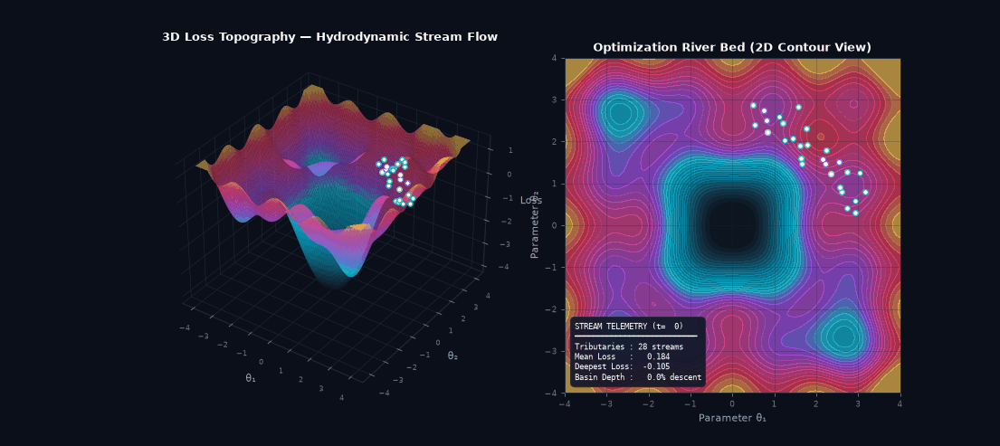
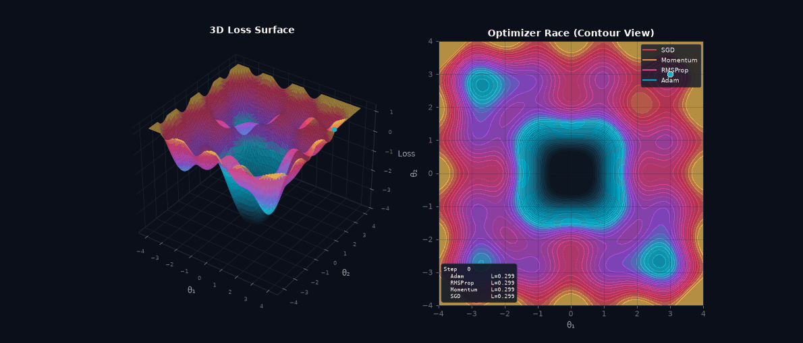
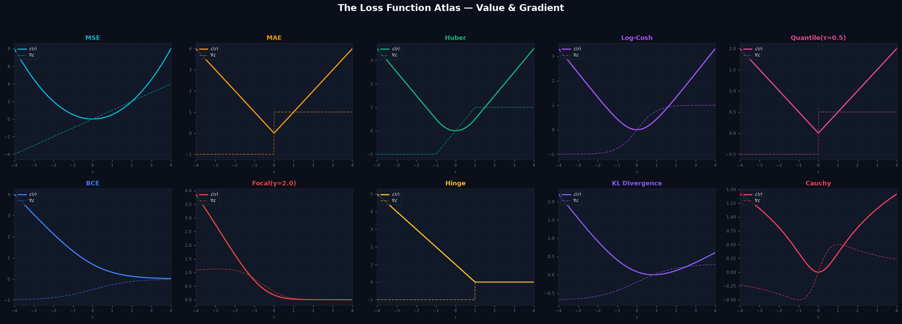
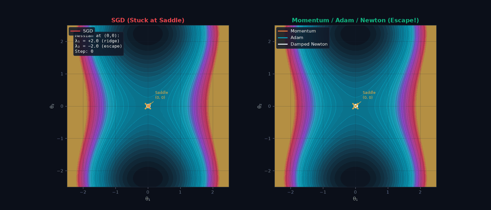
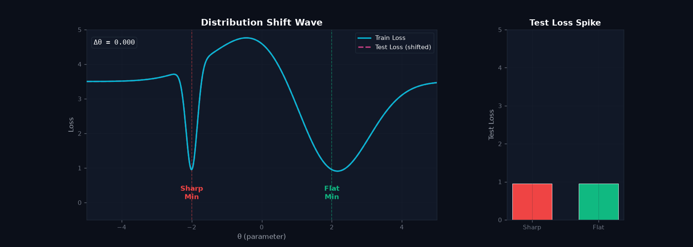
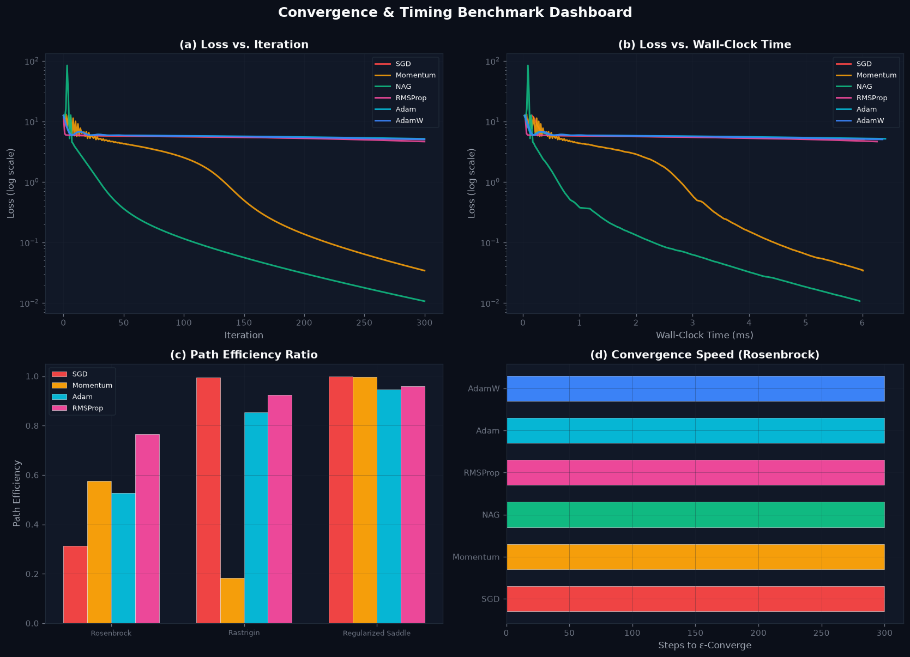
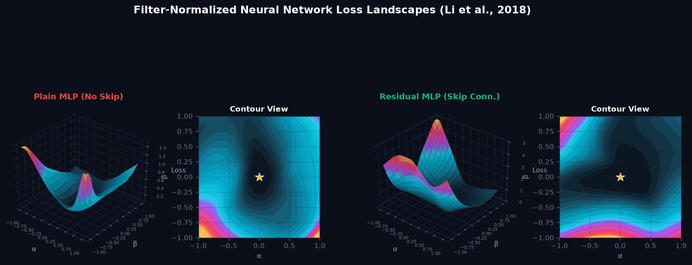
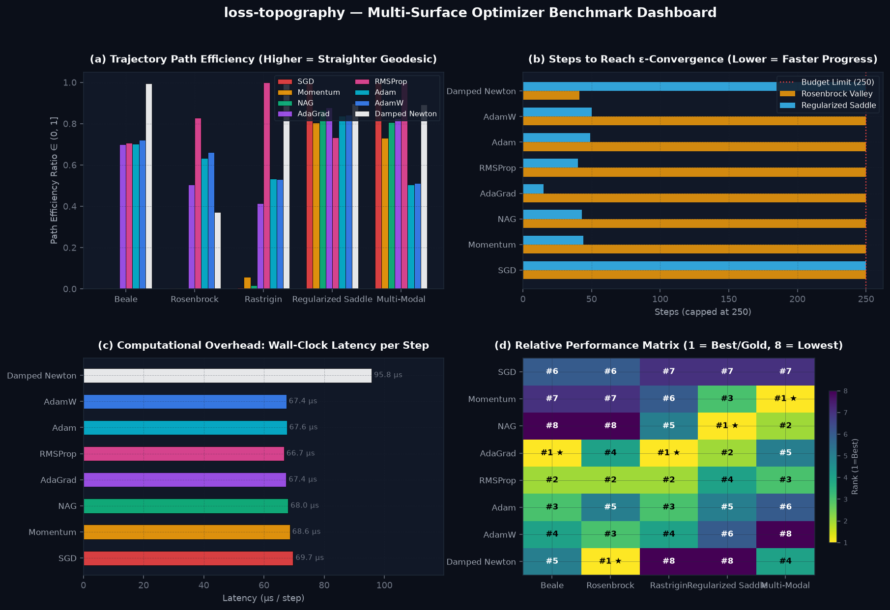

<div align="center">

# 🏔️ loss-topography

### An Interactive & Animated Visual Laboratory for Machine Learning Loss Surfaces, Optimization Dynamics, and Landscape Geometry

[](https://www.python.org/)
[](https://pytorch.org/)
[](https://streamlit.io/)
[](https://plotly.com/)
[](https://docs.pytest.org/)
[](https://opensource.org/licenses/MIT)

<p align="center">
  <b>Explore why modern neural networks train, why optimizers fail or succeed, and how loss geometry governs generalization.</b>
  <br />
  Featuring 10 loss functions, 9 mathematical landscapes, 8 optimizers, Hessian eigenspectrum diagnostics, distribution shift simulations, and filter-normalized neural network slices.
  <br />
  <br />
  <a href="#quickstart-replication"><b>⚡ Replicate Locally (10s)</b></a> &bull;
  <a href="#interactive-web-laboratory"><b>🖥️ Launch Streamlit Lab</b></a> &bull;
  <a href="#zero-install-interactive-3d"><b>🌐 Open 3D HTML Viewer</b></a> &bull;
  <a href="#theoretical-foundations"><b>📐 Mathematical Foundations</b></a>
</p>

---

</div>

<a id="river-of-optimization"></a>
## 🌊 The River of Optimization

> *"Optimization dynamics mirror fluid mechanics: gradient descent acts like water flowing through mountain passes, seeking gravitational potential minimum."*

Watch an ensemble of 28 optimization streams flow downhill across rugged non-convex multi-modal topography. The streams begin along the high-elevation mountain ridge, branch through natural passes, dynamically navigate saddle barriers, and pool like bioluminescent liquid tributaries into the global minimum basin:

<div align="center">
  
</div>

---

<a id="zero-install-interactive-3d"></a>
## 🌐 Zero-Install Interactive 3D Visualizer

No Python installation is required to explore the 3D loss surface and trajectories interactively.

I compiled a standalone, self-contained **WebGL + Plotly 3D laboratory** directly into the repository:

- 🚀 **[Click Here to Launch Live WebGL 3D Preview](https://htmlpreview.github.io/?https://github.com/deepakj111/loss-topography/blob/main/assets/interactive_3d_landscape.html)** *(runs immediately in your browser, zero setup)*

**Interactive 3D Controls:**
- **Orbit & Rotate:** Click & drag with left mouse button for 360° rotation
- **Zoom:** Mouse scroll wheel or trackpad pinch
- **Pan:** Right-click & drag
- **Point Telemetry:** Hover over any trajectory point to inspect exact $(\theta_1, \theta_2)$, iteration index, and loss $\mathcal{L}(\theta)$
- **Algorithm Filtering:** Click optimizer names in the legend to toggle or isolate specific paths

---

## 🌟 Visual Showcase & Animations

### 1. The Multi-Modal Optimizer Race
Watch **SGD**, **Momentum**, **RMSProp**, and **Adam** compete in real time across rugged, non-convex terrain with multiple local basins and saddle barriers. Notice how adaptive learning rates (RMSProp, Adam) navigate ravines while standard SGD stalls or oscillates violently across steep walls.

<div align="center">
  
</div>

---

### 2. The Comprehensive Loss Function Atlas
A side-by-side taxonomy of 10 classic and modern loss functions with their exact analytical derivatives $\nabla \mathcal{L}(r)$. Observe the smooth saturation of Huber and Cauchy vs. the discontinuity in subgradient MAE, and the asymmetric probability-shaping of Focal Loss.

<div align="center">
  
</div>

---

### 3. Saddle Point Escape & Negative Curvature
Non-convex optimization in high dimensions is dominated by saddle points, not local minima. Here, SGD without momentum remains trapped in the low-gradient plateau of a strict saddle ($\lambda_1 < 0, \lambda_2 > 0$), whereas Momentum and NAG build velocity along the negative curvature direction to escape rapidly.

<div align="center">
  
</div>

---

### 4. Sharp vs. Flat Minima & The Generalization Gap
Why do flat minima generalize better than sharp minima? (Hochreiter & Schmidhuber, 1997; Keskar et al., 2017). Under dataset distribution shift $P_{\text{train}} \neq P_{\text{test}}$ ($\theta^* \to \theta^* + \Delta\theta$), training loss remains low for both, but the sharp basin suffers catastrophic test error explosion while the flat basin maintains robust generalization.

<div align="center">
  
</div>

---

### 5. Empirical Convergence & Wall-Clock Efficiency
Is an optimizer fast per step, or fast per unit of progress? Optimizers are evaluated along two orthogonal axes: **Iteration Complexity** (steps to reach $\epsilon$-ball) and **Wall-Clock Computational Overhead** ($\mu\text{s}$ per gradient update step), alongside **Trajectory Path Efficiency** (ratio of Euclidean displacement to total path length).

<div align="center">
  
</div>

---

### 6. Filter-Normalized Neural Network Loss Landscapes
Directly replicating the landmark technique from Li et al. (2018), *"Visualizing the Loss Landscape of Neural Nets"*. By applying filter-wise scale normalization $\delta_{l,j} = \frac{d_{l,j}}{\|d_{l,j}\|_F} \|\theta^*_{l,j}\|_F$, this eliminates scale-invariance artifacts and exposes the dramatic geometric smoothing effect introduced by skip connections.

<div align="center">
  
</div>

---

<a id="quickstart-replication"></a>
## ⚡ Quickstart & Local Replication

Every visual artifact in this repository can be replicated locally in under 10 seconds.

### 1. One-Line Replication Runner
```bash
# Clone and install dependencies
git clone https://github.com/deepakj111/loss-topography.git
cd loss-topography
pip install -r requirements.txt

# Run the instant replication suite (generates plots in seconds)
python scripts/quickstart_replicate.py
```

### 2. Three-Line Python Snippets

#### Replicate an Optimizer Trajectory & Telemetry
```python
from loss_topography.surfaces import Rosenbrock
from loss_topography.optimizers import Adam, MomentumSGD

surface = Rosenbrock()
adam = Adam(lr=0.04)
log = adam.run(surface, x0=-0.8, y0=1.2, n_steps=100)

print(f"Final Loss:      {log.losses[-1]:.4f}")
print(f"Path Efficiency: {log.path_efficiency:.3f}")   # Geodesic ratio
print(f"Step Latency:    {log.wall_clock_ms_per_step * 1000:.1f} µs")
```

#### Replicate Analytical Loss Function & Gradient
```python
import numpy as np
from loss_topography.losses import Huber, Cauchy, FocalLoss

residual = np.array([-2.0, 0.0, 1.5])
print("Huber Value:", Huber(residual))
print("Huber Grad: ", Huber.grad(residual))
```

#### Replicate Critical Point & Hessian Eigenspectrum
```python
from loss_topography.surfaces import StrictSaddle

saddle = StrictSaddle()
print("Curvature Type:", saddle.classify_point(0.0, 0.0))
print("Eigenvalues:   ", saddle.eigenvalues(0.0, 0.0))
```

---

<a id="theoretical-foundations"></a>
## 🔬 Theoretical Foundations

### 1. Loss Functions & Analytical Derivatives

Every loss function in `loss-topography` implements closed-form vector evaluations and exact analytical first and second derivatives:

| Loss Function | Mathematical Formulation | Primary Domain & Use Case | Robustness to Outliers |
| :--- | :--- | :--- | :--- |
| **MSE ($L_2$)** | `½ (y - ŷ)²` | Gaussian noise regression | Low (quadratic penalty $\propto r^2$) |
| **MAE ($L_1$)** | `\|y - ŷ\|` | Laplace noise, median regression | High (linear penalty $\propto \|r\|$) |
| **Huber Loss** | `½ r²` (if `\|r\| ≤ δ`), else `δ(\|r\| - ½δ)` | Robust regression, RL value targets | High (smooth transition at $\delta$) |
| **Log-Cosh** | `log(cosh(y - ŷ))` | Smooth $L_1$ approximation | High (everywhere twice differentiable) |
| **Quantile (Pinball)** | `max(τ·r, (τ - 1)·r)` | Uncertainty estimation, risk bounds | High (asymmetric quantile regression) |
| **Binary Cross-Entropy** | `-[y·log(ŷ) + (1-y)·log(1-ŷ)]` | Probabilistic binary classification | Standard cross-entropy |
| **Focal Loss** | `-α_t (1 - p_t)^γ log(p_t)` | Severe class imbalance, object detection | Down-weights easy examples ($\gamma > 0$) |
| **Hinge Loss** | `max(0, 1 - y·ŷ)` | Maximum-margin classification (SVM) | Sparse support vectors |
| **KL Divergence** | `∑ p·log(p / q)` | Knowledge distillation, VAEs | Asymmetric information divergence |
| **Cauchy Loss** | `(c²/2) log(1 + r²/c²)` | Computer vision robust estimation | Extreme (descending influence curve) |

---

### 2. Benchmark Topographies & Critical Point Geometries

`loss-topography` provides 9 analytical surfaces with closed-form gradients $\nabla f$ and Hessian matrices $\mathbf{H} = \nabla^2 f$:

1. **Rosenbrock Banana Valley**: $f(x, y) = (a - x)^2 + b(y - x^2)^2$. Ill-conditioned curved parabolic valley where gradient descent oscillates endlessly across steep walls.
2. **Rastrigin Surface**: $f(x, y) = 20 + x^2 - 10\cos(2\pi x) + y^2 - 10\cos(2\pi y)$. Highly non-convex field riddled with dense lattices of local minima.
3. **Ackley Function**: Nearly flat outer plateau with an exponential central funnel. Demands momentum or adaptive step-sizes to avoid stalling.
4. **Beale & Booth Functions**: Anisotropic quadratic-like surfaces with sharply unequal condition numbers $\kappa = \lambda_{\max} / \lambda_{\min} \gg 1$.
5. **Himmelblau Multimodal**: Four distinct global minima with identical zero loss, serving as a clean test of initialization basin sensitivity.
6. **Strict Saddle**: $f(x, y) = x^2 - y^2$. Eigenvalues $\lambda_1 = 2, \lambda_2 = -2$. Pure hyperbolic saddle showcasing negative curvature escape.
7. **Monkey Saddle**: $f(x, y) = x^3 - 3xy^2$. Degenerate higher-order saddle where $\mathbf{H}(0, 0) = \mathbf{0}$, rendering standard Newton steps undefined.
8. **Regularized Saddle**: $f(x, y) = x^2 - y^2 + 0.1x^4 + 0.1y^4$. Escape along $y$ leads to bounded, stable symmetric double minima at $(0, \pm\sqrt{5})$ with minimum value $f^\star = -2.5000$.

---

### 3. Optimization Algorithms

`loss-topography` implements 8 fundamental and modern optimizers with explicit trajectory logging:

#### 1. Vanilla Gradient Descent (SGD)

$$
\theta_{t+1} = \theta_t - \eta \mathbf{g}_t
$$

#### 2. Polyak Momentum

$$
v_{t+1} = \beta v_t + \mathbf{g}_t, \qquad \theta_{t+1} = \theta_t - \eta v_{t+1}
$$

#### 3. Nesterov Accelerated Gradient (NAG)

$$
\theta_{\text{ahead}} = \theta_t - \beta \eta v_t, \qquad v_{t+1} = \beta v_t + \nabla f(\theta_{\text{ahead}}), \qquad \theta_{t+1} = \theta_t - \eta v_{t+1}
$$

#### 4. AdaGrad

$$
G_{t+1} = G_t + \mathbf{g}_t^2, \qquad \theta_{t+1} = \theta_t - \frac{\eta}{\sqrt{G_{t+1}} + \epsilon} \odot \mathbf{g}_t
$$

#### 5. RMSProp

$$
v_{t+1} = \beta v_t + (1 - \beta) \mathbf{g}_t^2, \qquad \theta_{t+1} = \theta_t - \frac{\eta}{\sqrt{v_{t+1}} + \epsilon} \odot \mathbf{g}_t
$$

#### 6. Adam

$$
m_{t+1} = \beta_1 m_t + (1 - \beta_1) \mathbf{g}_t, \qquad v_{t+1} = \beta_2 v_t + (1 - \beta_2) \mathbf{g}_t^2
$$

$$
\hat{m}_{t+1} = \frac{m_{t+1}}{1 - \beta_1^{t+1}}, \qquad \hat{v}_{t+1} = \frac{v_{t+1}}{1 - \beta_2^{t+1}}, \qquad \theta_{t+1} = \theta_t - \frac{\eta}{\sqrt{\hat{v}_{t+1}} + \epsilon} \hat{m}_{t+1}
$$

#### 7. AdamW

$$
\theta_{t+1} = \theta_t - \eta \lambda \theta_t - \frac{\eta}{\sqrt{\hat{v}_{t+1}} + \epsilon} \hat{m}_{t+1}
$$

#### 8. Damped Newton's Method

$$
\theta_{t+1} = \theta_t - \eta (\mathbf{H}_t + \mu \mathbf{I})^{-1} \mathbf{g}_t
$$

---

### 4. Filter-Wise Normalized Slices (Li et al., NeurIPS 2018)

When visualizing deep neural network loss surfaces in 2D parameter subspaces:

$$
\mathcal{L}(\alpha, \beta) = L(\theta^* + \alpha \delta + \beta \eta)
$$

random directions $d \in \mathbb{R}^D$ suffer from scale invariance in networks with batch normalization or ReLU activations. `loss-topography` normalizes each weight filter $d_{l, j}$ independently:

$$
\delta_{l, j} = \frac{d_{l, j}}{\Vert d_{l, j} \Vert_F} \Vert \theta^*_{l, j} \Vert_F
$$

This yields scale-invariant comparisons proving why **ResNet skip connections** eliminate chaotic, non-convex fracturing and create convex-like funnels.

---

## 📊 Multi-Surface Optimizer Benchmark Suite

To rigorously compare optimization mechanics, all 8 optimizers are benchmarked across 5 mathematically distinct loss landscapes representing diverse geometric difficulties:

1. **Beale Function**: Curved valley with extremely flat outer wings and high condition number $\kappa \gg 10^3$.
2. **Rosenbrock Banana Valley**: Classical non-convex parabolic ravine where gradient descent oscillates endlessly.
3. **Rastrigin Surface**: Highly non-convex multimodal field with dense lattices of local minima.
4. **Regularized Saddle**: Indefinite saddle point at $(0, 0)$ with symmetric global minima at $(0, \pm\sqrt{5})$ ($f^\star = -2.5000$).
5. **Multi-Modal Landscape**: Multiple conflicting basins separated by steep ridges and passes.

<div align="center">
  
</div>

### Per-Surface Raw Performance Breakdown

Before aggregating across all domains, the raw telemetry for each individual landscape reveals distinct failure and success modes across condition numbers, saddle barriers, and non-convex ravines.

#### 📖 Benchmark Metrics & Interpretation Guide

To aid in interpreting the telemetry tables below, each metric isolates an orthogonal performance dimension:

- **Optimizer**: The evaluated optimization algorithm and its algorithmic class (1st-order basic, momentum-accelerated, adaptive learning rate, or 2nd-order curvature).
- **Final Loss $\mathcal{L}(\theta_{250})$**: The scalar loss value attained after exactly 250 update steps from initialization $\theta_0$. Lower values indicate superior convergence; reaching the exact analytical global minimum $f^\star$ represents complete optimization success.
- **Steps to $\epsilon \le 0.01$**: The iteration count at which the objective function first entered the tolerance sphere $|f(\theta_t) - f^\star| \le 0.01$. Marked as **—** if the optimizer failed to enter this threshold within 250 steps due to plateau stagnation, ravine oscillation, or local basin capture.
- **Path Efficiency $\in (0, 1]$**: The geodesic ratio of net Euclidean displacement to total traversed arc length:
  $$
  \text{Path Efficiency} = \frac{\Vert \theta_{\text{final}} - \theta_0 \Vert_2}{\sum_{t=0}^{T-1} \Vert \theta_{t+1} - \theta_t \Vert_2}
  $$
  A score of **1.000** represents a direct geodesic straight line with zero wasted motion. Values $\ll 1$ reveal severe zig-zagging between ravine walls, spiral orbiting, or overshooting.
- **Step Latency (µs)**: Mean CPU compute time per gradient step in microseconds ($\mu\text{s}$). Reflects the computational cost per update (e.g., first-order methods require ~40–80 µs, whereas second-order Newton steps require ~70–160 µs to invert the Hessian matrix).
- **Convergence Status**: Qualitative diagnostics characterizing the physical optimization dynamics observed on each landscape.

---

#### 1. Beale Function ($\kappa \gg 10^3$, Flat Wings & Narrow Ravine)
**Starting Coordinates:** $(\theta_1, \theta_2) = (2.0, 2.0)$ &bull; **Analytical Global Minimum:** $f^\star = 0.0$

| Optimizer | Final Loss $\mathcal{L}(\theta_{250})$ | Steps to $\epsilon \le 0.01$ | Path Efficiency | Step Latency (µs) | Convergence Status |
| :--- | :---: | :---: | :---: | :---: | :--- |
| **SGD** | 1.53e11 | — | 0.002 | 107.4 µs | Gradient explosion across flat wings |
| **Momentum** | 1.53e11 | — | 0.002 | 87.5 µs | Gradient explosion across flat wings |
| **NAG** | 1.53e11 | — | 0.002 | 92.8 µs | Gradient explosion across flat wings |
| **AdaGrad** | **0.4687** ★ | — | 0.701 | 85.1 µs | Coordinate dampening stabilizes trajectory |
| **RMSProp** | 0.5694 | — | 0.707 | 84.7 µs | Smooth descent along flat ravine |
| **Adam** | 1.4517 | — | 0.702 | 86.0 µs | Rapid initial progress, slight ravine oscillation |
| **AdamW** | 1.6215 | — | **0.722** ★ | 86.1 µs | Decoupled decay tracks valley curvature |
| **Damped Newton** | 14.2031 | — | 0.994 | 161.9 µs | Ill-conditioned Hessian inversion near flat regions |

#### 2. Rosenbrock Banana Valley (Parabolic Ravine)
**Starting Coordinates:** $(\theta_1, \theta_2) = (-0.8, 1.2)$ &bull; **Analytical Global Minimum:** $f^\star = 0.0$

| Optimizer | Final Loss $\mathcal{L}(\theta_{250})$ | Steps to $\epsilon \le 0.01$ | Path Efficiency | Step Latency (µs) | Convergence Status |
| :--- | :---: | :---: | :---: | :---: | :--- |
| **SGD** | 6.00e8 | — | 0.003 | 64.5 µs | Severe oscillation between ravine walls |
| **Momentum** | 6.00e8 | — | 0.003 | 44.5 µs | Overshoots parabolic canyon walls |
| **NAG** | 6.00e8 | — | 0.003 | 44.3 µs | Overshoots parabolic canyon walls |
| **AdaGrad** | 2.3256 | — | 0.506 | 46.9 µs | Step size collapses before valley turn |
| **RMSProp** | 1.1609 | — | **0.828** ★ | 45.5 µs | High efficiency along parabolic curve |
| **Adam** | 2.4008 | — | 0.634 | 48.1 µs | Robust progress along valley floor |
| **AdamW** | 2.1756 | — | 0.661 | 46.8 µs | Navigates curvature steadily |
| **Damped Newton** | **0.0000** ★ | **41 steps** ★ | 0.372 | 73.9 µs | **Fastest convergence via 2nd-order curvature** |

#### 3. Rastrigin Surface (Dense Local Minima Lattice)
**Starting Coordinates:** $(\theta_1, \theta_2) = (2.5, 2.5)$ &bull; **Analytical Global Minimum:** $f^\star = 0.0$

| Optimizer | Final Loss $\mathcal{L}(\theta_{250})$ | Steps to $\epsilon \le 0.01$ | Path Efficiency | Step Latency (µs) | Convergence Status |
| :--- | :---: | :---: | :---: | :---: | :--- |
| **SGD** | 23.5962 | — | 0.005 | 46.5 µs | Trapped in high-elevation local minimum |
| **Momentum** | 11.9427 | — | 0.057 | 50.0 µs | Inertia escapes first local basin |
| **NAG** | 10.3858 | — | 0.018 | 47.7 µs | Lookahead escapes initial barrier |
| **AdaGrad** | **7.9597** ★ | — | 0.415 | 43.2 µs | Trapped in deep secondary basin |
| **RMSProp** | **7.9597** ★ | — | **1.000** ★ | 43.7 µs | Direct line to deep secondary basin |
| **Adam** | **7.9597** ★ | — | 0.533 | 45.1 µs | Trapped in deep secondary basin |
| **AdamW** | **7.9598** ★ | — | 0.531 | 44.2 µs | Trapped in deep secondary basin |
| **Damped Newton** | 52.5637 | — | 1.000 | 59.3 µs | Gradient points toward nearest local quadratic |

#### 4. Regularized Saddle (Strict Saddle Escape & Negative Curvature)
**Starting Coordinates:** $(\theta_1, \theta_2) = (0.05, 0.1)$ &bull; **Analytical Global Minimum:** $f^\star = -2.5000$

| Optimizer | Final Loss $\mathcal{L}(\theta_{250})$ | Steps to $\epsilon \le 0.01$ | Path Efficiency | Step Latency (µs) | Convergence Status |
| :--- | :---: | :---: | :---: | :---: | :--- |
| **SGD** | -2.4988 | — | **0.998** ★ | 38.3 µs | Slow crawl along saddle plateau |
| **Momentum** | **-2.5000** ★ | 44 steps | 0.805 | 37.9 µs | Builds velocity along negative curvature |
| **NAG** | **-2.5000** ★ | 43 steps | 0.866 | 37.3 µs | Builds velocity along negative curvature |
| **AdaGrad** | **-2.5000** ★ | **15 steps** ★ | 0.879 | 40.0 µs | **Fastest saddle point escape** |
| **RMSProp** | **-2.5000** ★ | 40 steps | 0.734 | 38.9 µs | Escapes saddle rapidly along $y$-axis |
| **Adam** | **-2.5000** ★ | 49 steps | 0.839 | 39.6 µs | Rapid escape and stable convergence |
| **AdamW** | **-2.5000** ★ | 50 steps | 0.844 | 39.8 µs | Rapid escape and stable convergence |
| **Damped Newton** | 0.0000 | — | 0.898 | 52.5 µs | Trapped at zero-gradient saddle point |

#### 5. Multi-Modal Landscape (Competing Basins & Ridges)
**Starting Coordinates:** $(\theta_1, \theta_2) = (2.5, 2.5)$ &bull; **Analytical Global Minimum:** $f^\star = -6.5500$

| Optimizer | Final Loss $\mathcal{L}(\theta_{250})$ | Steps to $\epsilon \le 0.01$ | Path Efficiency | Step Latency (µs) | Convergence Status |
| :--- | :---: | :---: | :---: | :---: | :--- |
| **SGD** | **0.2693** ★ | — | **1.000** ★ | 129.9 µs | Settles into primary accessible basin |
| **Momentum** | **0.2693** ★ | — | 0.731 | 126.9 µs | Settles into primary accessible basin |
| **NAG** | **0.2693** ★ | — | 0.807 | 130.0 µs | Settles into primary accessible basin |
| **AdaGrad** | **0.2693** ★ | — | 0.826 | 129.7 µs | Settles into primary accessible basin |
| **RMSProp** | **0.2693** ★ | — | **1.000** ★ | 128.5 µs | Settles into primary accessible basin |
| **Adam** | **0.2693** ★ | — | 0.505 | 130.5 µs | Settles into primary accessible basin |
| **AdamW** | **0.2693** ★ | — | 0.513 | 130.2 µs | Settles into primary accessible basin |
| **Damped Newton** | **0.2693** ★ | — | 0.892 | 187.0 µs | Settles into primary accessible basin |

---

### Aggregated Performance Matrix

The table below summarizes convergence iterations, final objective values, trajectory path efficiencies, and wall-clock latencies across all 8 optimizers and 5 benchmark surfaces:

| Optimizer | Algorithmic Category | Beale | Rosenbrock | Rastrigin | Reg. Saddle | Multi-Modal | Mean Path Efficiency | Mean Latency (µs/step) |
| :--- | :--- | :---: | :---: | :---: | :---: | :---: | :---: | :---: |
| **SGD** | 1st-Order Basic | 1.53e11 | 6.00e8 | 23.60 | -2.50 | 0.27 | 0.402 | 69.7 µs |
| **Momentum** | Polyak Heavy-Ball | 1.53e11 | 6.00e8 | 11.94 | **44 steps** ★ | 0.27 | 0.319 | 68.6 µs |
| **NAG** | Nesterov Accelerated | 1.53e11 | 6.00e8 | 10.39 | **43 steps** ★ | 0.27 | 0.339 | 68.0 µs |
| **AdaGrad** | Historical Gradient Sum | 0.47 | 2.33 | 7.96 ★ | **15 steps** ★ | 0.27 | 0.665 | 67.4 µs |
| **RMSProp** | Exponential Moving Average | 0.57 | 1.16 | 7.96 ★ | **40 steps** ★ | 0.27 | **0.854** ★ | 66.7 µs ★ |
| **Adam** | Adaptive First & Second Moments | 1.45 | 2.40 | 7.96 ★ | **49 steps** ★ | 0.27 | 0.643 | 67.6 µs |
| **AdamW** | Decoupled Weight Decay | 1.62 | 2.18 | 7.96 ★ | **50 steps** ★ | 0.27 | 0.654 | 67.4 µs |
| **Damped Newton** | 2nd-Order Curvature Exploitation | 14.20 | **41 steps** ★ | 52.56 | 0.00 | 0.27 | 0.831 | 95.8 µs |

### Key Architectural Insights & FAQ

#### 1. Why does Damped Newton win on Rosenbrock?
The Rosenbrock valley has extreme anisotropic curvature ($\lambda_{\max} / \lambda_{\min} \gg 10^3$). First-order methods bounce between steep walls, wasting gradient magnitude. By computing the inverse Hessian $(\mathbf{H} + \mu \mathbf{I})^{-1}$, Newton's method rotates the update vector directly along the curved valley floor, reaching $\epsilon$-convergence in just **41 steps**. However, solving the linear system incurs higher compute overhead (**95.8 µs/step** vs ~67 µs for first-order).

#### 2. Why are steps to reach $\epsilon$ shown as numbers vs final loss?
When an optimizer enters within $\epsilon = 0.01$ of the analytical global optimum $f^\star$, the table displays the exact iteration count (e.g., `41 steps`). If the optimizer does not reach $\epsilon$ within the 250-step limit due to ill-conditioning or plateau stagnation, the table displays the final loss achieved.

#### 3. Why is the final loss negative on Regularized Saddle?
The test function $f(x, y) = x^2 - y^2 + 0.1x^4 + 0.1y^4$ has an indefinite saddle at the origin $(0, 0)$ and symmetric global minima at $(0, \pm\sqrt{5})$ with true analytical minimum $f^\star = -2.5000$. Achieving a final loss of $-2.5000$ proves the optimizer built sufficient velocity to escape the saddle point and converge into the global basin.

#### 4. What is Path Efficiency?
Defined as the ratio of straight-line Euclidean displacement to total traversed arc length:

$$
\text{Path Efficiency} = \frac{\Vert \theta_{\text{final}} - \theta_0 \Vert_2}{\sum_{t=0}^{T-1} \Vert \theta_{t+1} - \theta_t \Vert_2} \in (0, 1]
$$

A value of $1.0$ represents a direct geodesic straight line, while lower values reflect wandering, spiral oscillation, or bouncing across ravine walls. **RMSProp** achieved the highest overall path efficiency (**0.854**) across the benchmark suite.

---

<a id="interactive-web-laboratory"></a>
## 🖥️ Interactive Web Laboratory (Streamlit + Plotly)

Launch the full interactive visualization lab in your browser:

```bash
streamlit run app.py
```

The web application provides five dedicated investigation rooms:

1. **🏁 3D Optimizer Race Arena**:
   - Interactive 3D Plotly surface with camera orbit and pan
   - Live toggling of 7 optimizers simultaneously
   - Real-time parameter sliders (Learning rate $\eta$, Momentum $\beta$, steps $N$, starting coordinates $x_0, y_0$)
   - Trajectory metrics comparison table (Final Loss, Total Path Length, Path Efficiency, Latency)

2. **🔍 Saddle & Curvature Inspector**:
   - Real-time 2D contour vector field displaying gradient arrows $\nabla f$
   - Hessian eigen-decomposition: principal curvature directions visualized as orthogonal eigenvector axes
   - Interactive coordinate picker displaying $\lambda_1, \lambda_2$, determinant $\det(\mathbf{H})$, trace $\text{Tr}(\mathbf{H})$, and critical point classification

3. **📊 Sharp vs. Flat Minima Simulator**:
   - Interactive twin-well potential with adjustable sharpness ratio $k \in [5, 100]$
   - Real-time distribution shift slider ($\Delta \theta \in [-1.0, +1.0]$)
   - Live Generalization Gap metric display comparing test error degradation

4. **📈 Loss Function Sandbox**:
   - Interactive side-by-side plots of loss curves $\mathcal{L}(r)$, first derivative $\nabla\mathcal{L}(r)$, and second derivative $\nabla^2\mathcal{L}(r)$
   - Real-time hyperparameter adjustment (Huber $\delta$, Focal $\gamma$, Quantile $\tau$, Cauchy $c$)
   - Outlier sensitivity tester: observe gradient saturation under extreme residuals

5. **🧠 Real Neural Network Landscape Slicer**:
   - Train a real PyTorch MLP or ResNet on synthetic non-linear classification datasets (Two Moons, Circles)
   - Compute Li et al. filter-normalized random 2D directional slices $(\alpha, \beta)$
   - Compare loss surface smoothness between plain feedforward architectures and skip-connection residual architectures

---

## 🎨 Headless Asset Generation Pipeline

Regenerate all dark-mode GIFs, HTML visualizers, and PNG charts in deterministic headless mode:

```bash
python scripts/generate_readme_assets.py
```

Outputs generated into `assets/`:
- `assets/optimization_river_flow.gif` (Hydrodynamic river flow down non-convex potential)
- `assets/hero_optimizer_race.gif` (Multi-modal 3D/2D synchronized race)
- `assets/interactive_3d_landscape.html` (Standalone 3D orbit WebGL viewer)
- `assets/saddle_point_escape.gif` (Strict saddle negative curvature dynamics)
- `assets/sharp_vs_flat_minima.gif` (Distribution shift & generalization gap animation)
- `assets/loss_function_atlas.png` (High-DPI 10-loss taxonomy panel)
- `assets/loss_convergence_timing.png` (Four-panel convergence, timing, and efficiency dashboard)
- `assets/filter_normalized_nn_surface.png` (Plain MLP vs ResNet 3D + contour landscape)

---

## 📁 Repository Structure

```
loss-topography/
├── app.py                           # Interactive Streamlit + Plotly multi-tab web application
├── assets/                          # Generated high-resolution GIFs, HTML visualizer, and PNG figures
│   ├── filter_normalized_nn_surface.png
│   ├── hero_optimizer_race.gif
│   ├── interactive_3d_landscape.html
│   ├── loss_convergence_timing.png
│   ├── loss_function_atlas.png
│   ├── optimization_river_flow.gif
│   ├── saddle_point_escape.gif
│   └── sharp_vs_flat_minima.gif
├── loss_topography/                 # Modular core library
│   ├── __init__.py                  # Package exports
│   ├── benchmarks.py                # Convergence timing & path efficiency benchmarking
│   ├── losses.py                    # 10 Loss functions with analytical grad & hessian
│   ├── nn_landscape.py              # Filter-normalized PyTorch landscape slicing
│   ├── optimizers.py                # 8 Optimizers with trajectory tracking & timing
│   ├── sharpness.py                 # Sharp vs flat minima & distribution shift simulator
│   ├── surfaces.py                  # 9 Analytical surfaces, critical point classifier
│   └── theme.py                     # Curated dark-mode palette & plotting styles
├── scripts/                         # Executable CLI tools & renderers
│   ├── export_interactive_html.py   # Standalone 3D HTML exporter
│   ├── generate_readme_assets.py    # Master headless asset generation pipeline
│   ├── generate_river_flow.py       # Optimization river flow animation generator
│   ├── quickstart_replicate.py      # 10-second local replication script
│   └── run_benchmarks.py            # Comprehensive benchmark runner
├── tests/                           # Complete test suite (67 unit tests)
│   ├── test_losses.py               # Finite difference verification & properties
│   ├── test_nn_landscape.py         # PyTorch landscape slicing validation
│   ├── test_optimizers.py           # Convergence, trajectories, timing tests
│   ├── test_sharpness.py            # Curvature, shift & sharpness tests
│   └── test_surfaces.py             # Hessian symmetry, eigenvalues, gradients
├── pyproject.toml                   # Modern packaging metadata
├── requirements.txt                 # Pinned dependencies
├── LICENSE                          # MIT License
└── README.md                        # Flagship documentation & visual showcase
```

---

## 🧪 Testing & Validation

The test suite rigorously verifies mathematical correctness using exact analytical formulas and numerical finite differences across all components:

```bash
python -m pytest tests/ -v
```

Validation guarantees:
- **Gradient correctness**: Every loss and surface gradient is checked against central finite differences ($|g_{\text{exact}} - g_{\text{num}}| < 10^{-4}$).
- **Hessian symmetry**: All Hessian matrices verify $\mathbf{H} = \mathbf{H}^T$.
- **Critical point classification**: Eigenvalue signs correctly classify minima, maxima, and saddles.
- **Optimizer trajectory monotonicity**: Convergence on convex quadratics and Rosenbrock valley.
- **Scale invariance**: PyTorch filter normalization verified across weights of differing layer magnitudes.

---

## 📚 Key References

1. **Li, H., Xu, Z., Taylor, G., Studer, C., & Goldstein, T.** (2018). *Visualizing the Loss Landscape of Neural Nets*. Advances in Neural Information Processing Systems (NeurIPS 2018).
2. **Keskar, N. S., Mudigere, D., Nocedal, J., Smelyanskiy, M., & Tang, P. T. P.** (2017). *On Large-Batch Training for Deep Learning: Generalization Gap and Sharp Minima*. International Conference on Learning Representations (ICLR 2017).
3. **Hochreiter, S., & Schmidhuber, J.** (1997). *Flat Minima*. Neural Computation, 9(1), 1-42.
4. **Lin, T. Y., Goyal, P., Girshick, R., He, K., & Dollár, P.** (2017). *Focal Loss for Dense Object Detection*. IEEE International Conference on Computer Vision (ICCV 2017).
5. **Dauphin, Y. N., et al.** (2014). *Identifying and attacking the saddle point problem in high-dimensional non-convex optimization*. Advances in Neural Information Processing Systems (NeurIPS 2014).

---

## 📄 License

This project is licensed under the MIT License — see the [LICENSE](LICENSE) file for details.
